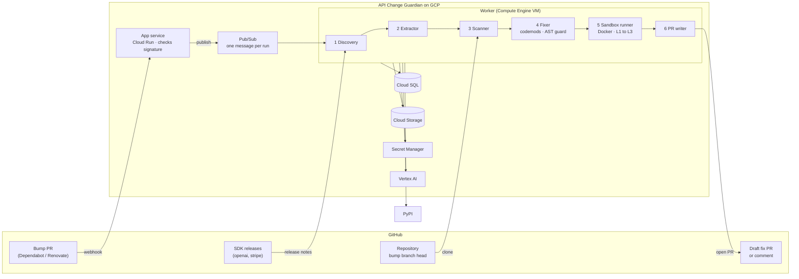

# API Change Guardian

> A GitHub App that makes SDK upgrade PRs mergeable. When Dependabot or Renovate bumps
> a Python SDK, it finds the call sites in your repository that the upgrade breaks and
> opens a **draft pull request with the fixes, tested against the new version**.

**Status:** 🚧 in development — see [docs](#-documentation) · [milestones](#-milestones)

---

## The problem

SDK upgrade PRs stall. A bump tool raises the version, CI goes red, and someone has to
read the release notes, find the affected calls and rewrite them. Many teams leave the
PR open instead and fall further behind with each release.

Dependabot and Renovate bump the version and attach release notes. With CI, they show
that something broke. They do **not** show which change caused it, and they do not
rewrite the call sites. Vendor migration tools exist only for the few migrations a
vendor chooses to support.

## The solution

API Change Guardian reacts to a bump PR for a watched SDK (`openai`, `stripe`):

1. **Discover** — reads the old → new version from the dependency-file diff, fetches
   the release notes for that range, and diffs the public API of the two versions
   (griffe).
2. **Extract** — an LLM with a strict JSON schema turns the notes into change records.
   A record is dropped if its evidence quote is not in the note or its symbol never
   existed. Changes the API diff confirms are high confidence; the rest are medium.
3. **Scan** — finds the affected call sites with libcst (imports, aliases, client
   variables). **No call site affected → no output.**
4. **Fix** — deterministic codemods, or an LLM diff that must pass an **AST guard**
   limiting it to the matched statements and SDK imports.
5. **Verify** — a Docker sandbox installs the new SDK (PyPI-only network, no secrets),
   then runs lint, type check and tests offline. The result is a level: L1, L2 or L3.
6. **Deliver** — a draft PR based on the bump branch. If the fix cannot be verified,
   one comment on the bump PR lists the affected call sites instead.

---

## Architecture



Locally, the same pipeline runs from a CLI with SQLite and Docker, and needs no cloud
account:

```bash
guardian run --repo PATH --package openai --from 1.30.0 --to 1.45.0
```

Full diagrams (sequence, data model, trust boundaries, deployment) →
[`docs/architecture.md`](docs/architecture.md)

---

## Safety design

| Rule | How it's enforced |
|---|---|
| Never pushes to the default branch or the bump branch; PRs are always **drafts**; a human merges | Separate `guardian/fix-…` branch; GitHub App flow |
| Release notes, repo code and test output are **untrusted data**, never instructions | No tools on any LLM call; schema-only output; evidence-quote and symbol-exists checks |
| An LLM diff can only touch matched statements and SDK imports | AST guard on every LLM diff |
| The app cannot change CI workflows | No Workflows permission |
| Untrusted repo code runs in a sandbox with **no secrets**; PyPI-only network for install, no network for checks | Two-phase Docker sandbox |
| Sandbox code cannot steal cloud credentials | Metadata server blocked; minimum-role service accounts |
| Repos with sensitive CI secrets can stop the app pushing code at all | Comment-only mode |
| One fix PR per bump PR; closed fix PRs are never reopened | `pull_requests` bookkeeping |

Residual risk: the AST guard narrows what an LLM diff can do but does not prove it
harmless. More detail → [`docs/system-guide.md`](docs/system-guide.md) § 5

---

## 📊 Results

Each pipeline stage is evaluated separately so failures can be traced. Methodology,
labeled data and fixture repos live in the repo. The numbers below are targets; the
measured column is filled from eval output, whether or not the targets are met.

| Eval | Dataset | Metric | Target | Measured |
|---|---|---|---|---|
| Extraction | 30 hand-labeled release notes | Precision / recall / wrong-symbol rate | ≥ 0.85 / ≥ 0.80 / < 5% | — |
| Scanner | 6–8 real repos, ~30 fixture cases, 5 negative repos | Call-site recall / precision (in-scope patterns) | ≥ 0.85 / ≥ 0.90 | — |
| Fix | Findings from the scanner set | Reach L2 or higher / false-confidence rate | ≥ 60% / < 10% | — |
| End-to-end | Replay of historical bump PRs | False-alert rate / median time to result | < 10% / < 10 min | — |

---

## 🚀 Quick start

*(lands with the Phase 0 and Phase 3 deliverables)*

```bash
git clone https://github.com/kavish924/API_agent.git
cd API_agent
cp .env.example .env
make dev
guardian run --repo ../some-repo --package openai --from 1.30.0 --to 1.45.0
```

Local runs need Python 3.12+ and Docker. Deploying to GCP is scripted in `deploy/`
(see [`specs/09-gcp-deployment.md`](specs/09-gcp-deployment.md)).

Stack: Python, FastAPI, Pydantic, SQLAlchemy, libcst, griffe, Docker, GitHub App
(REST API); on GCP: Cloud Run, Pub/Sub, Compute Engine, Cloud SQL, Cloud Storage,
Secret Manager, Vertex AI → full rationale in [`docs/tech-stack.md`](docs/tech-stack.md).

---

## 🗺 Milestones

| Week | Deliverables |
|---|---|
| 1 | Release fetcher with cache and revisions · griffe differ for a version range · LLM extraction with checks · 30-note extraction eval |
| 2 | libcst scanner with import, alias and client resolution · ignore rules · fixture repos · scanner eval with the grep baseline |
| 3 | Codemods · LLM fixer with AST guard · two-phase sandbox · `guardian run` works end to end locally |
| 4 | GitHub App behind a local webhook tunnel · draft fix PR · comment fallback · comment-only mode · fix eval |
| 5 | GCP deployment: Cloud Run, Pub/Sub, worker VM, Cloud SQL, Secret Manager, Vertex AI, deploy script |
| 6 | Replay eval on the deployed app · README results · demo video · buffer |

Stretch goals: type-aware scanning with Pyright, twilio-python, opening the app's own
bump PR for repos without Dependabot or Renovate.

## 🎥 Demo

> 🚧 A 2–3 minute video of a real bump PR turning into a draft fix PR will be linked
> here (week 6).

---

## ⚠️ Limitations

- **Python only**, two SDKs (`openai`, `stripe`).
- Acts only on SDK version bumps. Server-side changes that break pinned code (model
  retirements, endpoint sunsets) are out of scope.
- Response-shape and behavioural changes are reported with their call sites, not fixed.
- Wrapped clients and dynamically built calls are not detected; the miss rate is
  measured and published.
- No auto-merging; not a multi-tenant SaaS.

## 📚 Documentation

| Doc | Contents |
|---|---|
| [PRD v2](https://claude.ai/artifact/8ud7FGK43L3XkVkWmto4xm) | Product requirements (the PDF in this repo is v1 and superseded) |
| [`docs/system-guide.md`](docs/system-guide.md) | System guide: flow, components, pipeline stages, data model, safety rules |
| [`docs/tech-stack.md`](docs/tech-stack.md) | Every library and service and why it was chosen |
| [`docs/architecture.md`](docs/architecture.md) | Diagrams: overview, sequence, data model, trust boundaries, deployment |
| [`specs/`](specs/README.md) | One spec per feature with numbered requirements, acceptance criteria and the phase plan |

---

Built by [Kavish](https://github.com/kavish924) as an agentic-AI engineering portfolio
project.
