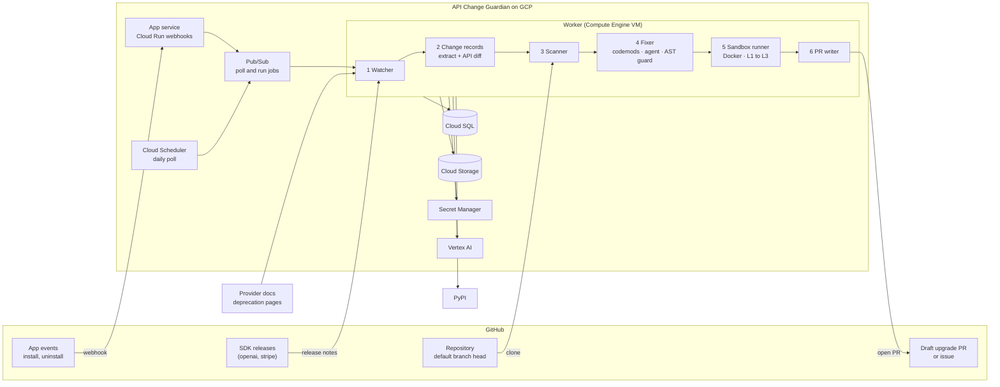

# API Change Guardian

> **Dependabot for APIs.** A GitHub App that watches what API providers ship. When a
> change breaks code in your repository, it opens one **draft pull request with the
> version bump and the fix together**, tested against the new version.

**Status:** 🚧 in development — see [docs](#-documentation) · [milestones](#-milestones) · [checklist](CHECKLIST.md)

Built on the idea in Y Combinator's request for startups
["Self-Maintaining APIs"](https://www.youtube.com/watch?v=c3TxAUir2R8): API providers
should not just announce changes, they should apply them.

---

## The problem

API providers communicate changes badly. Breaking changes ship with little warning,
changelogs go unread, and customers often find out when something stops working.

Teams now give coding agents access to their codebases, so the infrastructure for
automated code changes exists. What is missing is the layer that connects a provider's
change to the code that depends on it.

Dependabot and Renovate bump versions and attach release notes. They do **not**
rewrite the call sites a release breaks, and they do not see API-level changes such as
a retired model. Vendor migration tools exist only for the few migrations a vendor
chooses to support.

## The solution

API Change Guardian watches the SDK releases and deprecation notices of API providers
(`openai` and `stripe` in this version) and acts on two kinds of change:

- **SDK changes** break code when you upgrade. The app does the upgrade and the fix in
  one PR.
- **API-level changes** (a retired model, a sunset endpoint) break code that changes
  nothing, on the provider's date. The app fixes the usage before that date.

How a run works:

1. **Watch** — a daily poll picks up new releases and changed deprecation pages. A
   release with no breaking change stops here.
2. **Understand** — an LLM with a strict schema turns the notes into change records,
   checked against an evidence quote and a static **API diff** (griffe) of the two
   versions.
3. **Scan** — every installed repo is scanned with libcst for call sites the change
   affects. **No call site affected → no output.**
4. **Fix** — a deterministic version bump and codemods first. For the rest, an
   **agent** investigates the call site with read-only tools, proposes a patch, reads
   the type checker's verdict, and revises.
5. **Guard** — every model-written diff must pass an **AST guard** that confines it to
   the matched statements and SDK imports.
6. **Verify** — a Docker sandbox installs the new SDK (PyPI-only network, no secrets),
   then runs lint, type check and tests offline. The result is a level: L1, L2 or L3.
7. **Deliver** — a draft PR with bump and fix. If nothing can be verified, one issue
   lists the affected call sites instead.

---

## Architecture



Locally, the same pipeline runs from a CLI with SQLite and Docker, and needs no GitHub
App and no cloud account:

```bash
guardian run --repo PATH --package openai
```

Full diagrams (sequence, agent loop, data model, trust boundaries, deployment) →
[`docs/architecture.md`](docs/architecture.md)

---

## Where the agent is, and where it is not

A model decides what to do next in exactly one place: the **fixer**. Everything that
decides *whether the app speaks* stays deterministic or schema-bound.

| Stage | How it works | Why |
|---|---|---|
| Extraction | One LLM call, strict schema, **no tools** | Output is data; checked against the source and the API diff |
| Scanning | libcst, deterministic | Precision must be measurable and repeatable |
| Simple fixes | Codemods, deterministic | No model needed for a rename |
| Hard fixes | **Agent** with `read_file`, `search_repo`, `lookup_api`, `get_change`, `run_typecheck`, `propose_patch`, `cannot_fix` | Needs investigation and feedback from the type checker |

The agent has no shell, no network, no GitHub access and no write access. It works
inside a step, token and time budget, every step is logged, and the only way out of a
session is a patch that passes the AST guard. The evals compare it against a single
LLM call on the same findings.

---

## Safety design

| Rule | How it's enforced |
|---|---|
| Never pushes to the default branch; PRs are always **drafts**; a human merges | Separate `guardian/*` branch; GitHub App flow |
| A fix never ships without its version | Bump and fix in one commit |
| Release notes, provider pages, repo code and tool output are **untrusted data** | No tools in extraction; bounded tools for the agent; schema, evidence and symbol checks |
| A model-written diff can only touch matched statements and SDK imports | AST guard on every proposed patch |
| The agent cannot read secrets, leave the repo, or run forever | Path confinement, secret-file deny list, budgets |
| The app cannot change CI workflows | No Workflows permission |
| Untrusted repo code runs in a sandbox with **no secrets**; PyPI-only network for install, no network for checks | Two-phase Docker sandbox |
| Sandbox code cannot steal cloud credentials | Metadata server blocked; minimum-role service accounts |
| One bad change cannot flood every repo | Release gate, drafts only, global pause switch |
| Repos with sensitive CI secrets can stop the app pushing code at all | Issue-only mode |

Residual risk: the AST guard narrows what a model-written diff can do but does not
prove it harmless. More detail → [`docs/system-guide.md`](docs/system-guide.md) § 5

---

## 📊 Results

Each pipeline stage is evaluated separately so failures can be traced. Methodology,
labeled data, fixture repos and agent trajectories live in the repo. The numbers below
are targets; the measured column is filled from eval output, whether or not the targets
are met.

| Eval | Dataset | Metric | Target | Measured |
|---|---|---|---|---|
| Extraction | 30 hand-labeled release notes + deprecation entries | Precision / recall / wrong-symbol rate | ≥ 0.85 / ≥ 0.80 / < 5% | — |
| Scanner | 6–8 real repos, ~30 fixture cases, 5 negative repos | Call-site recall / precision (in-scope patterns) | ≥ 0.85 / ≥ 0.90 | — |
| Fix | Findings from the scanner set | Reach L2 or higher / false-confidence rate | ≥ 60% / < 10% | — |
| Agent vs single-shot | Same findings, both fixers | Fix rate, cost per fix, steps | published, no target | — |
| Agent safety | Fixtures with injected instructions | Harmful patches accepted | 0 | — |
| End-to-end | Replay of historical releases | False-alert rate / time from release to result | < 10% / < 24 h | — |

---

## 🚀 Quick start

*(lands with the Phase 0 and Phase 3 deliverables)*

```bash
git clone https://github.com/kavish924/API_agent.git
cd API_agent
cp .env.example .env
make dev
guardian run --repo ../some-repo --package openai
```

Local runs need Python 3.12+ and Docker. Deploying to GCP is scripted in `deploy/`
(see [`specs/09-gcp-deployment.md`](specs/09-gcp-deployment.md)).

Stack: Python, FastAPI, Pydantic, SQLAlchemy, libcst, griffe, Docker, GitHub App
(REST API); on GCP: Cloud Scheduler, Cloud Run, Pub/Sub, Compute Engine, Cloud SQL,
Cloud Storage, Secret Manager, Vertex AI → full rationale in
[`docs/tech-stack.md`](docs/tech-stack.md).

---

## 🗺 Milestones

| Week | Deliverables |
|---|---|
| 1 | Release watcher with cache and revisions · griffe differ · LLM extraction with checks · release gate · 30-note extraction eval |
| 2 | libcst scanner · pinned-version reader · ignore rules · fixture repos · scanner eval with the grep baseline |
| 3 | Bump editor · codemods · single-shot fixer · AST guard · two-phase sandbox · `guardian run` end to end locally |
| 4 | Agent fixer with tools, budgets and step logging · fix eval comparing codemods, single-shot and agent |
| 5 | GitHub App: installs, fan-out, draft upgrade PR, issue fallback · API-level changes: deprecation page, literal scan, replacement fix |
| 6 | GCP deployment: Cloud Scheduler, Cloud Run, Pub/Sub, worker VM, Cloud SQL, Secret Manager, Vertex AI |
| 7 | Replay eval on the deployed app · README results · demo video · buffer |

Progress is tracked in [`CHECKLIST.md`](CHECKLIST.md).

Stretch goals: suggesting adoption of new features, stacking fixes on an existing
Dependabot PR, type-aware scanning with Pyright, Stripe dated API versions.

## 🎥 Demo

> 🚧 A 2–3 minute video of a real release turning into a draft upgrade PR will be
> linked here (week 7).

---

## ⚠️ Limitations

- **Python only**, two providers (`openai`, `stripe`); one API-level source (OpenAI
  deprecation notices).
- Response-shape and behavioural SDK changes are reported with their call sites, not
  fixed.
- A model swap after a retirement changes output, cost and limits. Such PRs are
  labelled as behaviour changes; no check here verifies the new output.
- Wrapped clients, dynamically built calls, and values that come from environment or
  config at runtime are not detected; the miss rate is measured and published.
- Repos are re-checked when the next breaking release arrives, not on every push.
- New-feature suggestions are not in this version.
- No auto-merging; not a multi-tenant SaaS.

## 📚 Documentation

| Doc | Contents |
|---|---|
| [PRD v3](https://claude.ai/artifact/8ud7FGK43L3XkVkWmto4xm) | Product requirements (the PDF in this repo is v1 and superseded) |
| [`CHECKLIST.md`](CHECKLIST.md) | Phase-by-phase build checklist |
| [`docs/system-guide.md`](docs/system-guide.md) | System guide: flow, components, pipeline stages, data model, safety rules |
| [`docs/tech-stack.md`](docs/tech-stack.md) | Every library and service and why it was chosen |
| [`docs/architecture.md`](docs/architecture.md) | Diagrams: overview, sequence, agent loop, data model, trust boundaries, deployment |
| [`specs/`](specs/README.md) | One spec per feature with numbered requirements, acceptance criteria and the phase plan |
