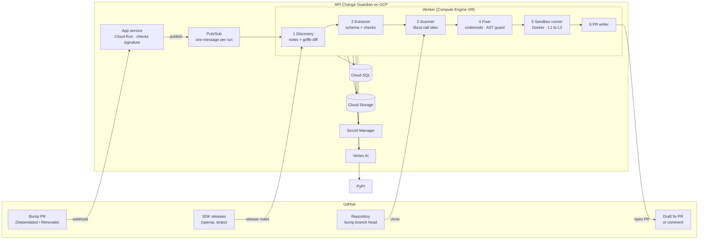
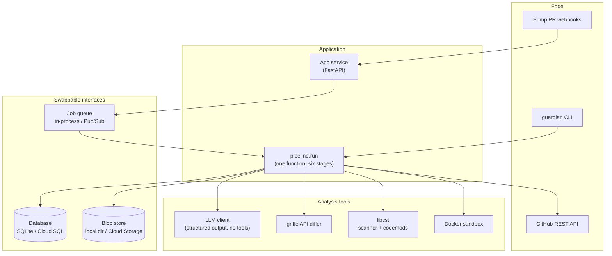
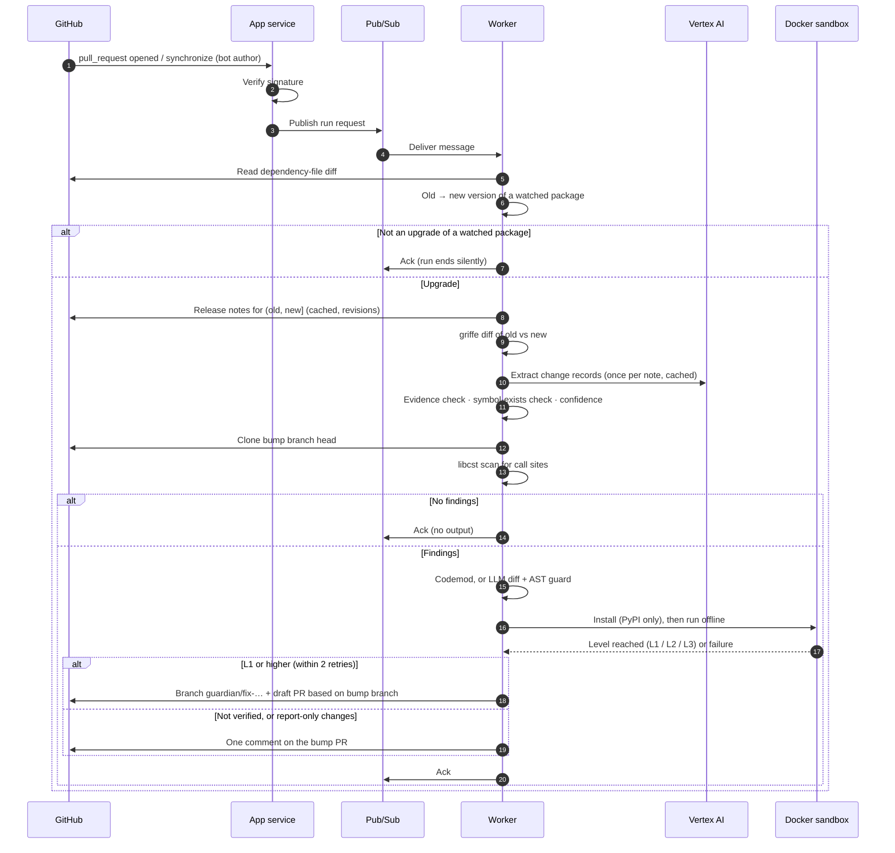
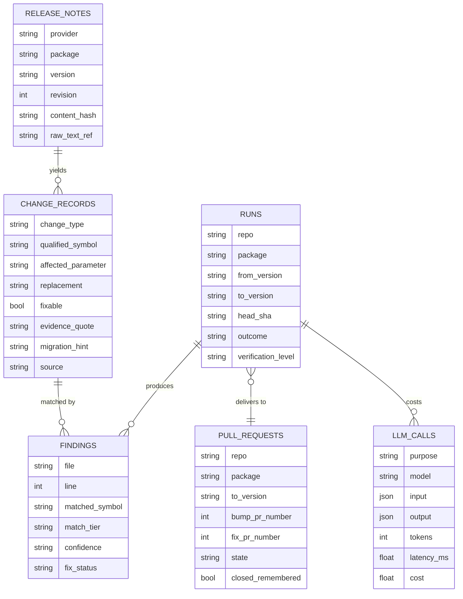
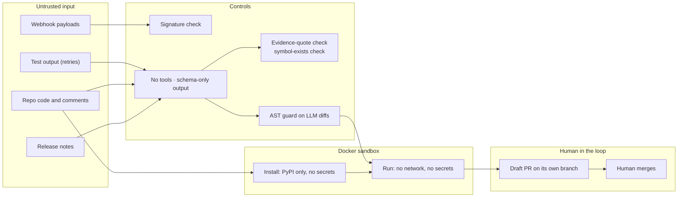

# API Change Guardian — Architecture

> Matches PRD v2 and the specs in [`../specs/`](../specs/README.md).
> Diagrams are [Mermaid](https://mermaid.js.org/), rendered natively on GitHub.

---

## 1. System overview

One trigger starts everything: a Dependabot or Renovate PR that bumps a watched SDK.

```text
Bump PR webhook -> App service -> queue -> Worker:
  discovery -> extraction -> scan -> fix -> sandbox -> draft fix PR / comment / nothing
```



**Components:** webhook service (Cloud Run), job queue (Pub/Sub), and one worker
(Compute Engine VM) that runs change discovery, the LLM extractor, the libcst scanner,
the fixer, the sandbox runner and the PR writer.

The webhook service only checks the signature and publishes a message. The worker is
the only part that reaches the database, storage, the LLM, the SDK release pages and
PyPI.

---

## 2. Layered view



The three interfaces at the bottom are why the same code runs on a laptop and on GCP.

---

## 3. End-to-end sequence



---

## 4. Data model



- `release_notes` is keyed on (package, version, revision). An edited note becomes a
  new revision, never a second record.
- `runs` is keyed on (repo, package, to_version, head_sha), which makes queue
  redelivery safe.
- `pull_requests` is keyed on (repo, package, to_version), which is how a closed fix
  PR is remembered.

---

## 5. Trust boundaries and safety design



| Threat | Control |
|---|---|
| Injected text steers extraction | No tools; schema-only output; evidence-quote and symbol-exists checks |
| Injected text steers the fixer into writing harmful code | AST guard: edits confined to matched statements and SDK imports; no new non-SDK imports; `.py` files with findings only |
| Fix branch runs in the repo's own CI, which may hold secrets | Same AST guard; no Workflows permission; comment-only mode pushes nothing |
| Repo code attacks the host during install or tests | Docker, non-root, no secrets, PyPI-only network for install, no network for run, CPU and time limits |
| Sandbox reads the VM's service-account token from the metadata server | Firewall rule blocks 169.254.169.254 from the Docker networks; minimum roles on the worker's service account |
| Leaked or over-broad cloud credentials | Separate service accounts for the webhook service and the worker; secrets only in Secret Manager |
| Forged or flooding webhooks | Signature check on every request; Cloud Run max instances capped |

Residual risk: the AST guard narrows what an LLM diff can do but does not prove it
harmless. Repos with sensitive CI secrets should use comment-only mode.

---

## 6. Deployment view

### On GCP

```text
                     GitHub
        webhook (HTTPS, signed)      REST API (installation token)
              │                              ▲
              ▼                              │
   ┌──────────────────┐   publish   ┌─────────────────────────────────────────┐
   │ Cloud Run        │────────────►│ Pub/Sub topic  ──►  pull subscription    │
   │ App service      │             │                    (+ dead-letter topic) │
   └──────────────────┘             └───────────────────┬─────────────────────┘
                                                        │ pull
                                                        ▼
   ┌────────────────────────── Compute Engine VM ──────────────────────────────┐
   │  worker (systemd)  ──►  pipeline.run                                      │
   │        │                                                                  │
   │        └──►  Docker sandbox:  install net (PyPI-only proxy) │ run (no net) │
   │              firewall: sandbox networks ✕ 169.254.169.254                 │
   └───────┬──────────────┬──────────────┬──────────────┬─────────────────────┘
           ▼              ▼              ▼              ▼
       Cloud SQL    Cloud Storage  Secret Manager   Vertex AI
```

- The worker is a VM because the sandbox must start containers with the network off,
  and Cloud Run cannot start containers from inside a container.
- One run at a time on the VM. The VM can be stopped between demos; Cloud Run scales
  to zero.

### Local

```text
guardian CLI ──► pipeline.run ──► SQLite · local blob directory · local Docker sandbox
```

No GitHub App and no cloud account are needed for local runs. Details →
[`../specs/09-gcp-deployment.md`](../specs/09-gcp-deployment.md)
