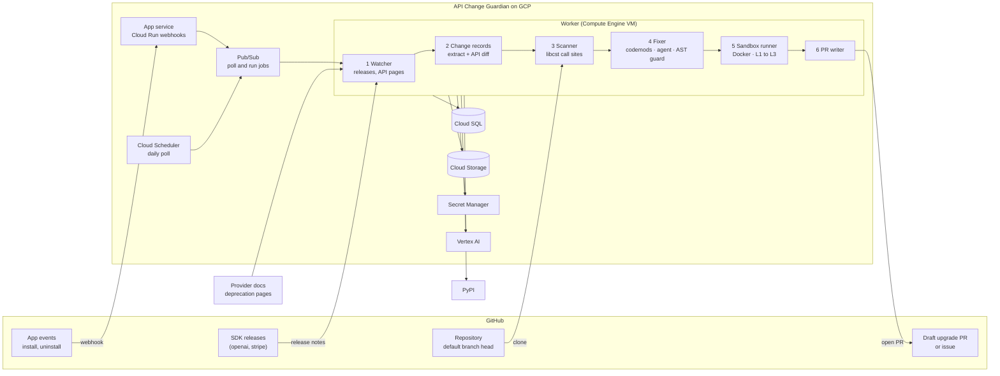
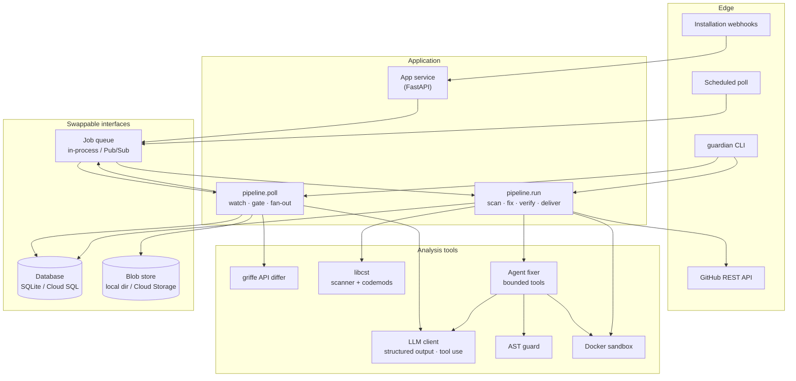
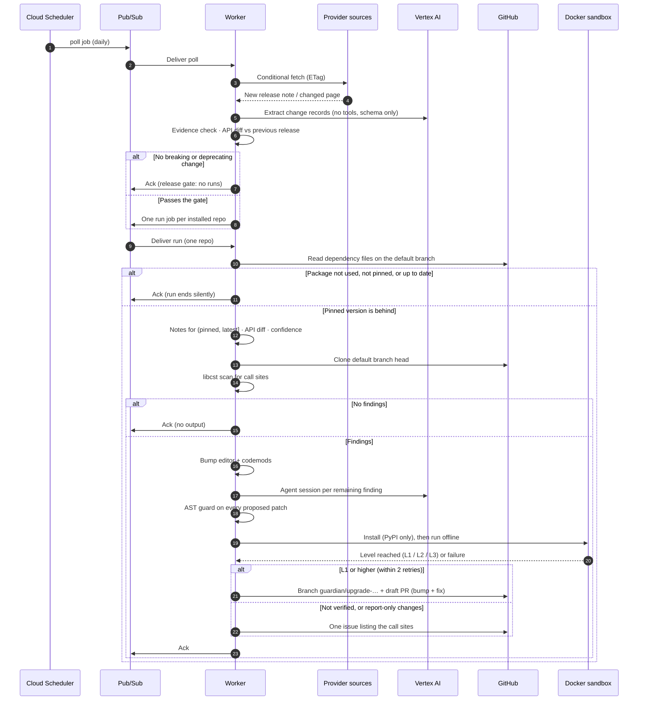
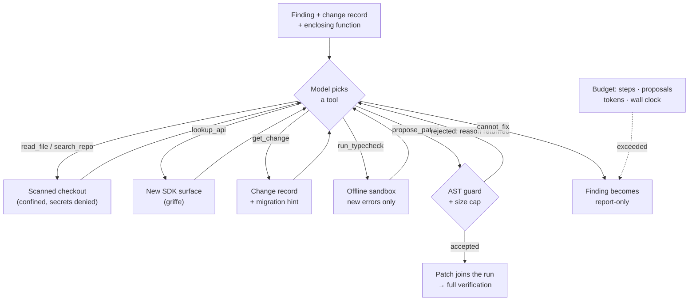
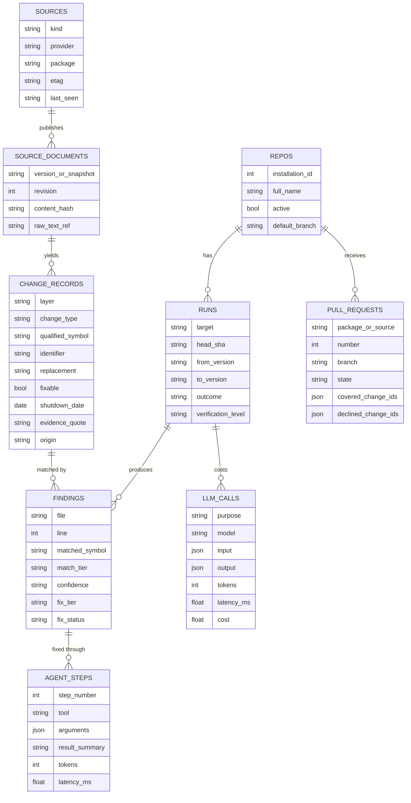
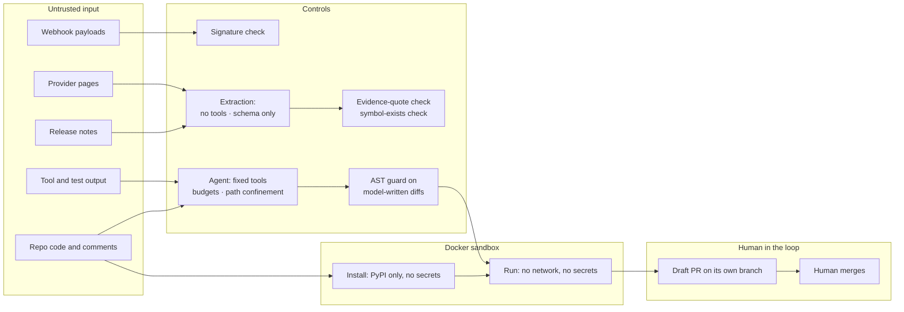

# API Change Guardian — Architecture

> Matches PRD v3 and the specs in [`../specs/`](../specs/README.md).
> Diagrams are [Mermaid](https://mermaid.js.org/), rendered natively on GitHub.

---

## 1. System overview

The trigger is the provider: a new SDK release or a changed deprecation page. A daily
poll finds it, and one run starts per installed repository.

```text
Daily poll -> watcher -> change records -> release gate -> fan-out (one run per repo):
  scan -> fix (bump · codemods · agent · AST guard) -> sandbox -> draft upgrade PR / issue / nothing
```



**Components:** scheduler (Cloud Scheduler), webhook service (Cloud Run), job queue
(Pub/Sub), and one worker (Compute Engine VM) that runs the watcher, change-record
builder, scanner, fixer, sandbox runner and PR writer.

The webhook service only checks the signature and publishes a job. The worker is the
only part that reaches the database, storage, the LLM, GitHub, PyPI and provider pages.

---

## 2. Layered view



The three interfaces at the bottom are why the same code runs on a laptop and on GCP.

---

## 3. End-to-end sequence



---

## 4. The agent fixer loop

The fixer is the one place where a model chooses the next action. It can read, check
and propose. It cannot run commands, reach the network, or write to the repo.



Every step is written to `agent_steps`, so a session can be replayed. A single-shot
mode (one LLM call, no tools) runs on the same findings for comparison in the evals.

---

## 5. Data model



- `source_documents` is keyed on (source, version or snapshot, revision). An edited
  note becomes a new revision, never a second record.
- `runs` is keyed on (repo, target, head SHA), which makes queue redelivery safe. A
  target looks like `openai@1.45.0` or `openai-deprecations@rev7`.
- `pull_requests` remembers the change IDs a closed PR covered, so the same changes
  are never proposed twice.

---

## 6. Trust boundaries and safety design



| Threat | Control |
|---|---|
| Injected text steers extraction | No tools; schema-only output; evidence-quote and symbol-exists checks |
| One poisoned release note reaches every installed repo through fan-out | Same checks; drafts only; the pause switch; fixes still pass the guard per repo |
| Injected text in a repo file steers the agent into writing harmful code | AST guard on every proposed patch: edits confined to matched statements and SDK imports; no new non-SDK imports; `.py` files with findings only |
| Agent reads secrets committed in the repo and sends them to the model | Read tools confined to the checkout; secret-looking files denied; output size caps |
| Agent runs away in a loop or runs up cost | Step, proposal, token and time budget per finding; per-run cost cap |
| Agent reaches outside the repo | No shell, network, GitHub or write tools; path checks reject escapes and symlinks |
| PR branch runs in the repo's own CI, which may hold secrets | Same AST guard; no Workflows permission; issue-only mode pushes nothing |
| Repo code attacks the host during install or tests | Docker, non-root, no secrets, PyPI-only network for install, no network for run, CPU and time limits |
| Sandbox reads the VM's service-account token from the metadata server | Firewall rule blocks 169.254.169.254 from the Docker networks; minimum roles on the worker's service account |
| Leaked or over-broad cloud credentials | Separate service accounts for the webhook service and the worker; secrets only in Secret Manager |
| Forged or flooding webhooks | Signature check on every request; Cloud Run max instances capped |

The structural defence is what a model's output is allowed to do, not what the prompt
asks of it. Residual risk: the AST guard narrows what a model-written diff can do but
does not prove it harmless. Repos with sensitive CI secrets should use issue-only mode.

---

## 7. Deployment view

### On GCP

```text
   Cloud Scheduler ── daily poll ──┐                GitHub
                                   │      webhook (signed)    REST API (installation token)
                                   │            │                       ▲
                                   ▼            ▼                       │
                           ┌──────────────────────────┐   ┌──────────────────┐
                           │ Pub/Sub topic            │◄──│ Cloud Run        │
                           │  jobs: poll · run · event│   │ App service      │
                           │  (+ dead-letter topic)   │   └──────────────────┘
                           └───────┬──────────▲───────┘
                              pull │          │ publish run jobs (fan-out)
                                   ▼          │
   ┌────────────────────────── Compute Engine VM ──────────────────────────────┐
   │  worker (systemd)  ──►  pipeline.poll / pipeline.run                      │
   │        │                                                                  │
   │        └──►  Docker sandbox:  install net (PyPI-only proxy) │ run (no net) │
   │              firewall: sandbox networks ✕ 169.254.169.254                 │
   └───────┬──────────────┬──────────────┬──────────────┬─────────────────────┘
           ▼              ▼              ▼              ▼
       Cloud SQL    Cloud Storage  Secret Manager   Vertex AI
```

- The worker is a VM because the sandbox must start containers with the network off,
  and Cloud Run cannot start containers from inside a container.
- One run at a time on the VM. The VM can be stopped between demos; Cloud Run scales
  to zero.
- A pause switch stops every write to GitHub without a deploy.

### Local

```text
guardian CLI ──► pipeline.poll / pipeline.run ──► SQLite · local blob directory · local Docker sandbox
```

No GitHub App and no cloud account are needed for local runs. Details →
[`../specs/09-gcp-deployment.md`](../specs/09-gcp-deployment.md)
