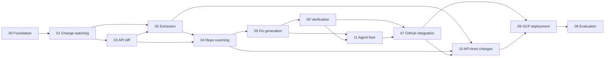

# Specs — API Change Guardian

Spec-driven development (SDD): **every feature gets a written spec before code.** A
feature is "done" only when its acceptance criteria are demonstrably met and its spec
status is updated.

**Source of truth:** PRD v3 ([Claude doc](https://claude.ai/artifact/8ud7FGK43L3XkVkWmto4xm)).
The PDF in the repo root is PRD v1 and is superseded. These specs were rewritten for
v3 on 2026-11-13; see section 6 for what changed.

**Product in one line:** "Dependabot for APIs". When a provider ships a breaking
change, the app scans every installed repo and opens one draft PR that holds the
version bump and the code fix together.

---

## 1. How SDD works in this repo

Each feature follows the same loop:

```text
spec drafted → reviewed → implemented → verified against acceptance criteria → spec closed
```

- **One spec per feature**, numbered `NN-<slug>.md`, all in this folder.
- Specs use a fixed template: Goal → User stories → Requirements (numbered IDs) →
  Acceptance criteria → Technical notes → Test plan → Out of scope → Open questions.
- Requirement IDs are local to a spec (`F1.1` = spec 01, requirement 1). Each spec
  header names the PRD v3 section it covers. A test file that covers a requirement
  references the ID (e.g. `test_watch.py  # covers F1.2, F1.3`).
- Statuses: `Draft → Approved → In progress → Implemented → Verified`.
- No code lands for a feature whose spec is still `Draft`.

---

## 2. Spec index

| Spec | Feature | PRD v3 ref | Phase | Status |
|---|---|---|---|---|
| [`00-foundation.md`](./00-foundation.md) | Project scaffold, config, DB schema, interfaces, CLI, CI | §8 | 0 | Verified |
| [`01-change-discovery.md`](./01-change-discovery.md) | Change watching, release gate, fan-out, version range | FR1, FR2 | 1 | Draft |
| [`03-api-surface-diffing.md`](./03-api-surface-diffing.md) | API diff; confidence and symbol checks; API lookup | FR2 | 1 | Draft |
| [`02-extraction.md`](./02-extraction.md) | Structured extraction (LLM) | FR2 | 1 | Draft |
| [`04-repo-scanning.md`](./04-repo-scanning.md) | Repository scanning (libcst) | FR4 | 2 | Draft |
| [`05-fix-generation.md`](./05-fix-generation.md) | Bump editor, codemods, single-shot fixer, AST guard | FR5 | 3 | Draft |
| [`06-verification.md`](./06-verification.md) | Two-phase sandbox verification, levels L1 to L3 | FR6 | 3 | Draft |
| [`11-agent-fixer.md`](./11-agent-fixer.md) | Agent fixer: tools, budgets, step logging | FR5 | 4 | Draft |
| [`07-github-integration.md`](./07-github-integration.md) | GitHub App: installs, upgrade PR, issue fallback | FR7 | 5 | Draft |
| [`10-api-level-changes.md`](./10-api-level-changes.md) | API-level changes: deprecation notices | FR3 | 5 | Draft |
| [`09-gcp-deployment.md`](./09-gcp-deployment.md) | Deployment on Google Cloud | §7, §8 | 6 | Draft |
| [`08-evaluation.md`](./08-evaluation.md) | Evaluation harness and published results | §9, §11 | 1–7 | Draft |

Cross-cutting rules (apply to **all** specs, from PRD v3 §7):

- Never push to the default branch; PRs are always drafts; a human merges.
- A fix always ships with its version: SDK fixes go in the same commit as the bump.
- Four inputs reach a model and **all are untrusted**: release notes, provider web
  pages, repository code and comments, and tool or test output. They are data, never
  instructions.
- **Extraction has no tools.** The **agent fixer** has a fixed allow-list of tools
  (spec 11): no shell, no network, no GitHub, no write access.
- Every model-written diff passes the AST guard (spec 05) before it is used.
- Every LLM call and every agent step is logged.
- Runs are idempotent, keyed on (repo, target, default-branch commit). Retries use
  backoff; GitHub secondary rate limits are handled.
- No findings means no output: no PR, no issue.
- Deterministic first: a model is used only where no deterministic tool does the job.
- The whole pipeline runs from the CLI with no GitHub App and no cloud resources.

---

## 3. Implementation phases

Phases map to PRD v3's 7-week timeline. A phase has explicit **exit** criteria; do not
start the next phase until they are met, or a descope decision is recorded in the
affected spec's "Open questions / decisions".

### Phase 0 — Foundation (days 1–2)
- Specs: [`00-foundation.md`](./00-foundation.md)
- **Exit:** one command sets up a local environment; migrations create all tables on
  SQLite; CI runs lint, types and tests; `guardian --help` works.

### Phase 1 — Know the changes (week 1)
- Specs: [`01-change-discovery.md`](./01-change-discovery.md),
  [`03-api-surface-diffing.md`](./03-api-surface-diffing.md),
  [`02-extraction.md`](./02-extraction.md)
- **Exit:** `guardian poll` detects a new release, stores its note, extracts change
  records and applies the release gate; for a package and a version range, a checked
  list of change records with confidence exists; the 30-note extraction eval runs.

### Phase 2 — Know the repo (week 2)
- Specs: [`04-repo-scanning.md`](./04-repo-scanning.md)
- **Exit:** the pinned version is read from a repo; the scanner resolves imports,
  aliases and client variables; no findings ends the run silently; fixture repos
  exist; scanner eval runs with the grep baseline.

### Phase 3 — Fix and verify (week 3)
- Specs: [`05-fix-generation.md`](./05-fix-generation.md),
  [`06-verification.md`](./06-verification.md)
- **Exit:** `guardian run` produces a patch with bump and fix for codemod and
  single-shot cases; every model-written diff passes the AST guard or is rejected; the
  sandbox reports a verification level.

### Phase 4 — Agent fixer (week 4)
- Specs: [`11-agent-fixer.md`](./11-agent-fixer.md)
- **Exit:** the agent fixes findings no codemod handles, within budget, with every
  step logged; the fix eval compares codemods, single-shot and agent.

### Phase 5 — GitHub App and API-level changes (week 5)
- Specs: [`07-github-integration.md`](./07-github-integration.md),
  [`10-api-level-changes.md`](./10-api-level-changes.md)
- **Exit:** installing the App on a test repo starts a catch-up run; a release that
  affects the repo produces a draft upgrade PR; the issue fallback and closed-PR
  memory work; one deprecation notice produces a PR or issue end to end.

### Phase 6 — Google Cloud (week 6)
- Specs: [`09-gcp-deployment.md`](./09-gcp-deployment.md)
- **Exit:** one script deploys everything; the daily poll runs from Cloud Scheduler; a
  real release produces a PR through the deployed app; the metadata canary passes.

### Phase 7 — Prove it (week 7)
- Specs: [`08-evaluation.md`](./08-evaluation.md)
- **Exit:** all evals run with published results; README results are generated from
  eval output; demo video recorded.

Cut order if time runs short (PRD v3 §10): stripe-python first, then L3 test
verification, then API-level auto-fix (report by issue only), then Cloud SQL (SQLite
on the worker VM).

---

## 4. Dependency graph



---

## 5. Spec template

Copy this for new specs:

```markdown
# Spec NN — <Feature name>
Status: Draft | Approved | In progress | Implemented | Verified
Phase: N · PRD v3 ref: FRn · Depends on: specs …

## Goal
One paragraph: what this delivers and why it matters.

## User stories
- As a <role>, I <action> so that <benefit>.

## Requirements
| ID | Requirement |
|---|---|

## Acceptance criteria
- [ ] Concrete, testable statement (GIVEN/WHEN/THEN where useful).

## Technical notes
Key design decisions, data shapes, failure modes.

## Test plan
Which tests prove which requirement IDs.

## Out of scope
Explicit non-goals for this spec.

## Open questions / decisions
Unresolved items and any descope decisions (with dates).
```

---

## 6. What changed from the v2 specs (2026-11-13)

v3 returns the product to its source idea (YC's "Self-Maintaining APIs"): act when the
provider ships a change, cover API-level changes, and fix with a real agent.

| Area | v2 spec | v3 spec |
|---|---|---|
| Trigger | A Dependabot or Renovate bump PR (spec 07) | A daily poll detects provider changes and fans out one run per installed repo (spec 01) |
| Version range | Read from the bump PR's dependency-file diff | Old = the repo's pinned version on the default branch; new = the latest release |
| Output | Fix PR stacked on the bump branch; comment fallback | One draft upgrade PR with bump and fix against the default branch; issue fallback (spec 07) |
| Fixer | Codemods, then one LLM call (spec 05) | Codemods, then an agent with tools (new spec 11); single-shot kept as the eval baseline |
| Change sources | SDK release notes only | Adds provider deprecation pages (new spec 10) |
| Permissions | Contents, Pull requests, Metadata | Adds Issues; still no Workflows |
| GCP | Cloud Run, Pub/Sub, worker VM | Adds Cloud Scheduler and a pause switch (spec 09) |
| Evaluation | Four evals | Adds the codemod vs single-shot vs agent comparison (spec 08) |
| Timeline | 6 weeks | 7 weeks |

Unchanged: griffe API diff, evidence and symbol checks, libcst scanner, AST guard,
two-phase sandbox with levels L1 to L3.
