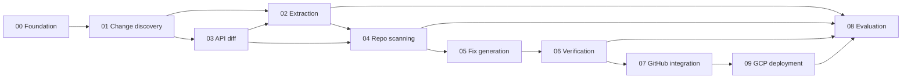

# Specs — API Change Guardian

Spec-driven development (SDD): **every feature gets a written spec before code.** A
feature is "done" only when its acceptance criteria are demonstrably met and its spec
status is updated.

**Source of truth:** PRD v2 ([Claude doc](https://claude.ai/artifact/8ud7FGK43L3XkVkWmto4xm)).
The PDF in the repo root is PRD v1 and is superseded. These specs were rewritten for
v2 on 2026-11-13; see section 6 for what changed.

---

## 1. How SDD works in this repo

Each feature follows the same loop:

```text
spec drafted → reviewed → implemented → verified against acceptance criteria → spec closed
```

- **One spec per feature**, numbered `NN-<slug>.md`, all in this folder.
- Specs use a fixed template: Goal → User stories → Requirements (numbered IDs) →
  Acceptance criteria → Technical notes → Test plan → Out of scope → Open questions.
- Requirement IDs are local to a spec (`F1.1` = spec 01, requirement 1). Each spec
  header names the PRD v2 section it covers. A test file that covers a requirement
  references the ID (e.g. `test_discovery.py  # covers F1.2, F1.3`).
- Statuses: `Draft → Approved → In progress → Implemented → Verified`.
- No code lands for a feature whose spec is still `Draft`.

---

## 2. Spec index

| Spec | Feature | PRD v2 ref | Phase | Status |
|---|---|---|---|---|
| [`00-foundation.md`](./00-foundation.md) | Project scaffold, config, DB schema, interfaces, CLI, CI | §8 | 0 | Draft |
| [`01-change-discovery.md`](./01-change-discovery.md) | Version range from the dependency diff; release notes for the range | FR1, FR2 | 1 | Draft |
| [`03-api-surface-diffing.md`](./03-api-surface-diffing.md) | API diff of old vs new version; confidence and symbol checks | FR2, FR3 | 1 | Draft |
| [`02-extraction.md`](./02-extraction.md) | Structured extraction (LLM) | FR3 | 1 | Draft |
| [`04-repo-scanning.md`](./04-repo-scanning.md) | Repository scanning (libcst) | FR4 | 2 | Draft |
| [`05-fix-generation.md`](./05-fix-generation.md) | Fix generation and the AST guard | FR5 | 3 | Draft |
| [`06-verification.md`](./06-verification.md) | Two-phase sandbox verification, levels L1 to L3 | FR6 | 3 | Draft |
| [`07-github-integration.md`](./07-github-integration.md) | GitHub App: bump-PR trigger, draft fix PR, comment fallback | FR1, FR7 | 4 | Draft |
| [`09-gcp-deployment.md`](./09-gcp-deployment.md) | Deployment on Google Cloud | §7, §8 | 5 | Draft |
| [`08-evaluation.md`](./08-evaluation.md) | Evaluation harness and published results | §9, §11 | 1–6 | Draft |

Cross-cutting rules (apply to **all** specs, from PRD v2 §7):

- Never push to the default branch or to the bump branch; fix PRs are always drafts;
  a human merges.
- Every run has an explicit old → new version range. Nothing is fixed, scanned or
  reported outside a run.
- Three inputs reach an LLM and **all three are untrusted**: release notes, repository
  code and comments, and test output fed back on retry. They are data, never
  instructions. No LLM call has tools.
- Every LLM call goes through the shared client and is logged to `llm_calls`
  (inputs, outputs, tokens, latency, cost).
- Runs are idempotent, keyed on (repo, package, target version, head SHA). Retries use
  backoff; GitHub secondary rate limits are handled.
- No findings means no output: no PR, no comment.
- The whole pipeline runs from the CLI with no GitHub App and no cloud resources.

---

## 3. Implementation phases

Phases map to PRD v2's 6-week timeline. A phase has explicit **exit** criteria; do not
start the next phase until they are met, or a descope decision is recorded in the
affected spec's "Open questions / decisions".

### Phase 0 — Foundation (days 1–2)
**Goal:** repo, tooling, data model and interfaces ready.
- Specs: [`00-foundation.md`](./00-foundation.md)
- **Exit:** one command sets up a local environment; migrations create all tables on
  SQLite; CI runs lint, types and tests on every push; `guardian --help` works.

### Phase 1 — Know the changes (week 1)
**Goal:** for a package and a version range, a checked list of change records exists.
- Specs: [`01-change-discovery.md`](./01-change-discovery.md),
  [`03-api-surface-diffing.md`](./03-api-surface-diffing.md),
  [`02-extraction.md`](./02-extraction.md)
- **Exit:** the range is read from a dependency-file diff; release notes for the range
  are fetched and cached with revisions; the griffe diff of old vs new runs; extraction
  emits schema-valid records and rejects bad evidence quotes; each record carries a
  confidence; the 30-note extraction eval runs.

### Phase 2 — Know the repo (week 2)
**Goal:** for a set of change records and a repo, correct call-site findings or silence.
- Specs: [`04-repo-scanning.md`](./04-repo-scanning.md)
- **Exit:** scanner resolves imports, aliases and client variables; ignore rules work;
  no findings ends the run silently; fixture repos exist; scanner eval runs with the
  grep baseline; a 500-file repo scans in under 30 seconds.

### Phase 3 — Fix and verify (week 3)
**Goal:** `guardian run` works end to end on a local repo.
- Specs: [`05-fix-generation.md`](./05-fix-generation.md),
  [`06-verification.md`](./06-verification.md)
- **Exit:** codemods handle renames and import changes; every LLM diff passes the AST
  guard or is rejected; the two-phase sandbox reports a verification level; the CLI
  prints the result a PR would contain.

### Phase 4 — GitHub App (week 4)
**Goal:** a real bump PR produces a draft fix PR or a comment.
- Specs: [`07-github-integration.md`](./07-github-integration.md)
- **Exit:** the App runs locally behind a webhook tunnel; opens a draft fix PR based on
  the bump branch; falls back to one comment; comment-only mode works; closed fix PRs
  are not reopened; the fix eval runs.

### Phase 5 — Google Cloud (week 5)
**Goal:** the same pipeline runs hosted on GCP.
- Specs: [`09-gcp-deployment.md`](./09-gcp-deployment.md)
- **Exit:** one script deploys everything; a bump PR on a test repo produces a fix PR
  through the deployed app; the metadata-server canary passes; a budget alert exists.

### Phase 6 — Prove it (week 6)
**Goal:** publish eval numbers, README and demo.
- Specs: [`08-evaluation.md`](./08-evaluation.md)
- **Exit:** all four evals run with published results; README results table is filled
  from eval output; demo video recorded; grep vs libcst chart in the README.

Cut order if time runs short (PRD v2 §10): stripe-python first, then L3 test
verification, then comment-only mode. If Phase 5 slips, Cloud SQL is replaced by
SQLite on the worker VM's disk.

---

## 4. Dependency graph



---

## 5. Spec template

Copy this for new specs:

```markdown
# Spec NN — <Feature name>
Status: Draft | Approved | In progress | Implemented | Verified
Phase: N · PRD v2 ref: FRn · Depends on: specs …

## Goal
One paragraph: what this delivers and why it matters.

## User stories
- As a <role>, I <action> so that <benefit>.

## Requirements
| ID | Requirement |
|---|---|

## Acceptance criteria
- [ ] Concrete, testable statement (GIVEN/WHEN/THEN where useful).

## Technical notes
Key design decisions, data shapes, failure modes.

## Test plan
Which tests prove which requirement IDs.

## Out of scope
Explicit non-goals for this spec.

## Open questions / decisions
Unresolved items and any descope decisions (with dates).
```

---

## 6. What changed from the v1 specs (2026-11-13)

| v1 spec | v2 spec |
|---|---|
| 01 Ingestion: daily poll of 3 SDKs, dedup on content hash | 01 Change discovery: on-demand fetch for one version range, cached by package and version with revisions. File renamed from `01-ingestion.md` |
| 02 Extraction: model reports its own confidence; verbatim evidence check | Confidence is assigned by the system from the API diff; evidence check normalises whitespace and Markdown; `fixable` flag added |
| 03 API diff: consecutive versions; diff overrides the LLM and rejects records | Exact old vs new version; diff-confirmed records are high confidence, notes-only records are kept at medium |
| 04 Scanning: tree-sitter; version gating against the pinned version | libcst with metadata providers; no gating, the run's range decides; ignore rules added |
| 05 Fix: diff size cap and file scope | Adds the AST guard on every LLM diff and a report-only path for non-fixable changes |
| 06 Verification: one offline Docker run; pass or fail | Two phases (install with PyPI-only network, run offline); levels L1 to L3; baseline run; "could not run" |
| 07 GitHub: installation webhooks; one PR per change; issue on failure; Issues permission | Triggered by Dependabot or Renovate bump PRs; one draft fix PR per bump PR, based on the bump branch; comment on failure; comment-only mode; no Issues or Workflows permission |
| 08 Evaluation: 40–50 notes, 15–20 real repos, alerts per month | 30 notes, 6–8 real repos plus about 30 fixture cases, false-alert rate |
| — | 09 GCP deployment (new) |
| Postgres + Redis + RQ via docker compose | SQLite locally; Cloud Run, Pub/Sub, a worker VM and Cloud SQL when deployed |
| 3 providers, 3 weeks | 2 providers (openai, stripe), 6 weeks |
